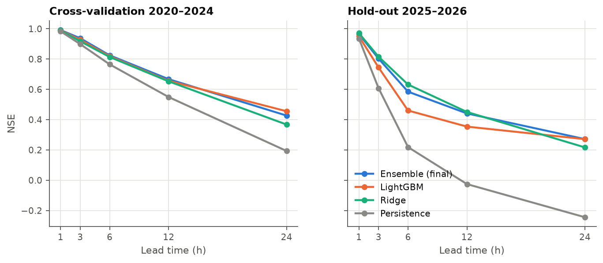
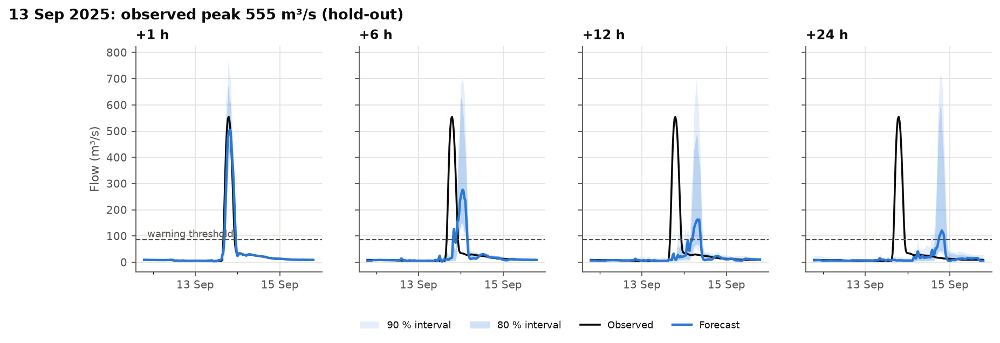
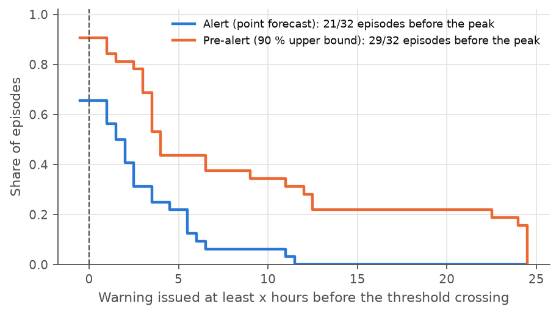
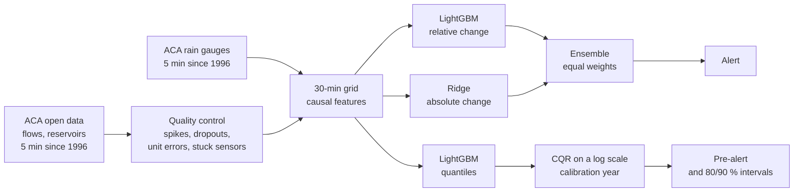

# Llobregat Flood Forecasting

[](https://github.com/joangordo/llobregat-flood-forecasting/actions/workflows/ci.yml)


Probabilistic streamflow and flood forecasting for the Llobregat River at Sant Joan Despí
(Barcelona, 4,908 km²), 1 to 24 hours ahead, every 30 minutes, with calibrated prediction
intervals and a two-level warning.

> **Not an official warning system.** This is a research project. For official
> information, see the [Agència Catalana de l'Aigua](https://aca.gencat.cat) and
> [Protecció Civil de Catalunya](https://interior.gencat.cat/ca/arees_dactuacio/proteccio_civil/).

**Live forecast:** [joangordo.github.io/llobregat-flood-forecast-live](https://joangordo.github.io/llobregat-flood-forecast-live/)
(GitHub Actions + GitHub Pages, updated every 30 minutes; code:
[llobregat-flood-forecast-live](https://github.com/joangordo/llobregat-flood-forecast-live)).



## Results at a glance

The system was frozen on cross-validation (test years 2020–2024) and then evaluated once on
a 2-year hold-out (hydrological years 2025–2026, October 2024 – September 2026):

| NSE | +1 h | +3 h | +6 h | +12 h | +24 h |
|---|---|---|---|---|---|
| Cross-validation 2020–2024, ensemble | 0.992 | 0.938 | 0.825 | 0.667 | 0.427 |
| Cross-validation 2020–2024, persistence | 0.983 | 0.899 | 0.765 | 0.549 | 0.193 |
| **Hold-out 2025–2026, ensemble** | **0.966** | **0.803** | **0.585** | **0.441** | **0.272** |
| Hold-out 2025–2026, persistence | 0.936 | 0.608 | 0.219 | −0.026 | −0.244 |

- **Better than persistence at every lead time**, in cross-validation (month-block bootstrap
  confidence intervals of the NSE difference exclude zero) and on the hold-out.
- **Early warning** (threshold: 87 m³/s, the 99th percentile of the training flows; a high
  flow, not necessarily a flood). Of the 32 hold-out episodes, the pre-alert (upper bound of
  the 90 % interval above the threshold) was issued before the observed crossing in 29, a
  median of 3.5 h ahead; the alert (point forecast above the threshold) in 21, a median of
  2 h ahead.
- **Calibrated intervals**: the 80 % and 90 % intervals covered 86–90 % and 94–96 % of the
  hold-out observations, with an interval score 35–50 % lower than a conformal interval
  around persistence.
- **Peaks are underestimated beyond a few hours**: on the hold-out the median peak error is
  −15 % at +3 h and −28 % at +6 h (see [Limitations](#limitations)).
- **Ridge alone did better on the hold-out** than the LightGBM + Ridge ensemble at 1–12 h
  (NSE 0.971 / 0.815 / 0.632 / 0.451) and with smaller peak errors. The ensemble was chosen
  on cross-validation and is kept: switching now would mean using the hold-out to decide.
  Whether Ridge is better will have to be tested on new years (2027 onwards).

The full tables, per-episode results and figures are produced by `llobregat report` (see
[docs/reproducing.md](docs/reproducing.md)); the model is described in the
[model card](docs/MODEL_CARD.md).

| | |
|---|---|
|  |  |

## How it works



| Step | Approach |
|---|---|
| Data | 5-minute flows at Sant Joan Despí and upstream gauges, daily reservoir outflows and volumes, 5-minute ACA rain gauges; 26 years (2000–2026) including storm Gloria (January 2020) |
| Quality control | Rules derived from reviewed real cases: isolated spikes, dropouts, excursions, oscillations, stuck and saturated sensors, L/s stretches stored as m³/s, daily balance against the official daily flow |
| Inputs | Chosen by a coverage rule (≥ 85 % of the training period), not by hand: 6 upstream gauges, 3 reservoirs and 9 rain gauges |
| Features | Own-flow lags, rolling means and maxima; upstream flows lagged up to 24 h (peak-to-peak travel times 4–15 h); rain per gauge, sub-basin and basin; antecedent precipitation index; season |
| Target | Relative change log(Q(t+h)+0.1) − log(Q(t)+0.1) for LightGBM and absolute change for Ridge; forecasts returned in m³/s |
| Feature selection | Near-duplicates removed on the development period; then sources (a gauge with all its lags, a rain gauge with all its sums...) are kept only if shuffling them on the inner validation makes the error worse |
| Point forecast | Equal-weight mean of LightGBM and Ridge; LightGBM hyperparameters tuned with Optuna on the first fold's inner validation and kept only where they improve the validation error by more than 5 % |
| Intervals | LightGBM quantile regression (5, 10, 90, 95 %) calibrated with asymmetric conformalized quantile regression on a log scale, using each fold's calibration year |
| Warnings | Pre-alert: upper bound of the 90 % interval above the warning threshold. Alert: point forecast above it |

## Validation design

Forward chaining by hydrological year (October–September), with 7-day gaps between blocks
so that no lagged feature or target crosses them:

```
fold 1:  train 2001–2018 | calib 2019 | test 2020   (inner validation: 2017–2018)
...
fold 5:  train 2001–2022 | calib 2023 | test 2024
final:   train 2001–2023 | calib 2024 | test 2025–2026   (hold-out, evaluated once)
```

- The feature analysis uses only the training years of the first fold.
- Source selection and hyperparameter tuning use inner validation years only.
- The calibration year is used only by the intervals and the warning rule.
- The hold-out was evaluated once, after the whole system was frozen; the command that
  runs it locks itself, and forcing it again is recorded.
- All models are scored on exactly the same rows; differences are tested with a
  month-block bootstrap and the Diebold–Mariano test.

## What did not work

Reported because negative results are results too (all evaluated on the same rows):

- **Tweedie loss on the flow level** (the approach of the earlier thesis model): trees
  cannot extrapolate above the largest training value; NSE 0.59 at 1 h against 0.99.
- **Flood-oriented sample weights**: better peak heights, but more false rises and a worse
  NSE at 12–24 h.
- **Linear trees**: unstable (NSE −18 at 3 h).
- **The short-record variant with all stations** (2018 onwards, 32 extra rain gauges):
  three training years are not enough; worse on the shared test years.
- **Adaptive conformal inference**: exact marginal coverage, but it widens the intervals
  right after each missed flood, when it is too late to matter.

## Limitations

- Forecast peaks arrive late and low beyond a few hours. On the hold-out, the median peak
  error is +0 % at +1 h, −15 % at +3 h, −28 % at +6 h and −47 % at +24 h, and from +6 h the
  forecast peak arrives about as late as persistence does. Many floods at Sant Joan Despí are
  generated by rain over the lower basin, 1.5–4 h upstream, so they cannot be anticipated
  without a rainfall forecast, which the system does not use. Useful lead time is therefore
  about 3–6 h, mostly through the pre-alert.
- The hold-out (2025–2026) was harder than the cross-validation years: NSE dropped from
  0.825 to 0.585 at +6 h, for persistence too (0.765 to 0.219): the flow changed faster
  than in the cross-validation years.
- The intervals were calibrated on a single drought year (2024) and were slightly too wide
  on the hold-out; during floods their coverage falls with the lead time.
- Rain comes from 9 ACA gauges. The 32 XEMA (Meteocat) stations only start in 2009 and did
  not meet the coverage rule for the 2000–2026 training period.

## Quick start

```bash
uv sync --all-extras
uv run pytest
uv run llobregat --help
```

The data are not included (see [Data](#data)). With the raw data in `data/raw/`, the whole
pipeline runs with `scripts/run_all.sh` (or `scripts\run_all.bat` on Windows); step by step:

```bash
uv run llobregat build-dataset --variant long        # 30-min table of features and targets
uv run llobregat analyse-features --variant long     # correlations, duplicates, travel times
uv run llobregat train --variant long                # baselines, Ridge and LightGBM, 5 folds
uv run llobregat compare --variant long              # comparison table, bootstrap, DM test
uv run llobregat intervals --variant long            # quantiles, CQR and warnings, 5 folds
uv run llobregat final-evaluation --variant long     # hold-out, once
uv run llobregat report --variant long               # tables and figures
uv run llobregat operational-model --variant long    # model files for the live app
```

## Repository layout

```
src/llobregat/
  ingest/           ACA open data, ACA rain gauge files, XEMA open data, Sentilo real-time API
  qc_flow.py        quality-control rules for the 5-min flows
  variants.py       input selection by coverage and validation folds
  dataset.py        30-min data table of each variant
  features.py       causal feature engineering and target transforms
  validation.py     forward-chaining folds by hydrological year
  analysis.py       correlations, near-duplicates, peak-to-peak travel times
  selection.py      grouped permutation importance (source selection)
  train.py          baselines, Ridge, LightGBM; pooled metrics; model comparison
  tuning.py         LightGBM hyperparameters with Optuna
  probabilistic.py  quantile LightGBM, CQR, ACI, warnings and the locked hold-out evaluation
  report.py         final tables and figures
  operational.py    retraining on all the data and the model loader used by the live app
  live.py           real-time inputs (ACA Sentilo API) -> same features -> forecasts
configs/stations/   one YAML file per forecast station (inputs, thresholds, QC exclusions)
tests/              unit tests, including tests for temporal leakage
docs/               model card, reproduction guide, figures
```

## Data

Code: MIT. The data are **not** in this repository and remain subject to their own terms
of use:

- [Agència Catalana de l'Aigua](https://aca.gencat.cat): flows and reservoirs from the
  [Catalan open data portal](https://analisi.transparenciacatalunya.cat) (downloaded with
  `llobregat aca-opendata`) and historical rain gauge records supplied on request.
- [Servei Meteorològic de Catalunya](https://www.meteo.cat): XEMA open data (only used by
  the short-record variant).

## Background

This project extends the author's bachelor's thesis in Statistics (Universitat de
Barcelona, 2026), which forecast the same station 1–6 h ahead with a LightGBM Tweedie
model trained on a short record. The extension uses the ACA historical archive since 1996,
quality control, a stricter validation design, prediction intervals and warnings, and a
cloud deployment. A Catalan version of this repository, with a detailed comparison with the
thesis, is at
[llobregat-prediccio-crescudes](https://github.com/joangordo/llobregat-prediccio-crescudes).

## Citation

See [CITATION.cff](CITATION.cff). A journal article based on this work is in preparation.
